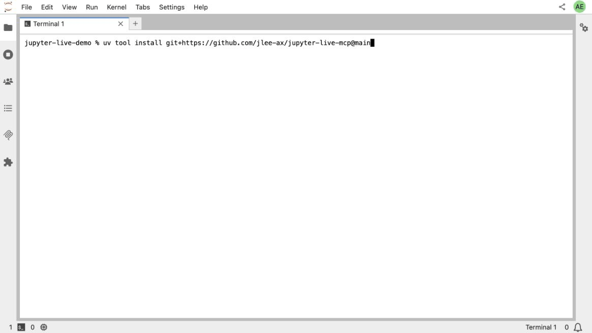
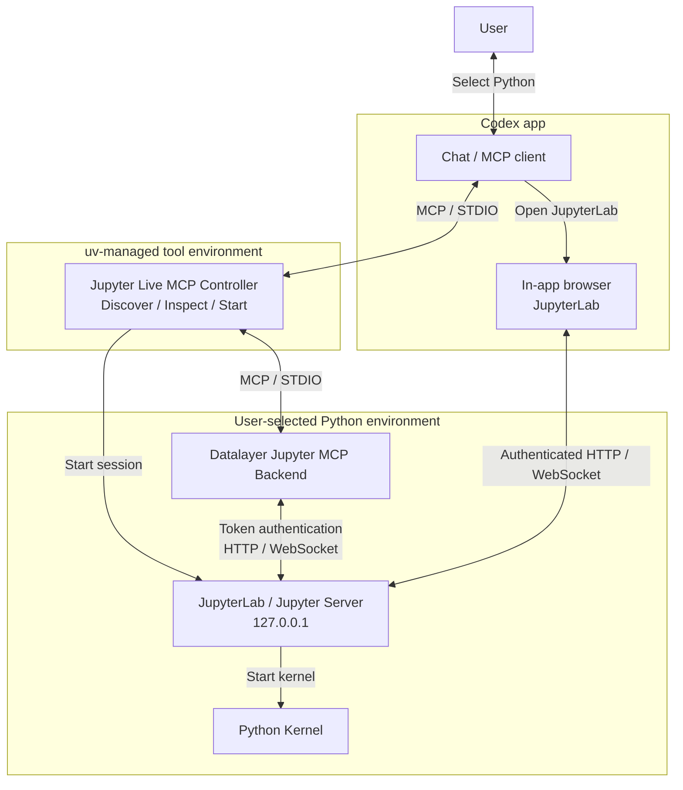

# Jupyter Live MCP

[English](README.md) | [한국어](README.ko.md)

사용자가 선택한 Python 환경에서 JupyterLab과 커널을 실행하고, Codex에 노트북 읽기·편집·실행 도구를 제공하는 MCP 서버입니다.

Codex 앱에서 노트북 작업을 요청하고, 내장 브라우저의 JupyterLab에서 편집·실행 결과를 확인합니다.



JupyterLab 터미널에서 촬영한 CLI 실행 예시입니다.

## 설치

Python 3.11 이상, `uv`, Codex 앱과 MCP 등록용 `codex` CLI가 필요합니다.

```sh
uv tool install git+https://github.com/jlee-ax/jupyter-live-mcp@main
codex mcp add jupyterLive -- jupyter-live-mcp serve
```

## 사용

Codex 앱에서 프로젝트를 열고 새 대화를 시작합니다.

> 이 프로젝트에서 Jupyter Live를 시작하세요. 사용할 Python 환경을 먼저 물어보고, JupyterLab을 내장 브라우저에 열어주세요.

Python 환경을 선택한 뒤 내장 브라우저의 JupyterLab에서 노트북을 확인합니다. 셀 읽기·편집·실행은 Codex 대화에서 요청합니다.

## 아키텍처

Jupyter 실행 전에 Python 환경을 선택할 수 있도록 컨트롤러를 `uv`가 관리하는 도구 전용 환경에서 실행합니다. Jupyter 서버·MCP 백엔드·노트북 커널은 선택한 Python으로 실행합니다.



## Python 환경

Codex에서 프로젝트의 가상환경이나 Conda 환경을 선택하거나, Python 실행 파일 경로를 지정합니다. 새 가상환경은 기반 Python과 생성 경로를 지정해 만듭니다.

분석 환경에는 Python 3.11 이상과 다음 패키지가 필요합니다.

| 패키지 | 버전 |
| --- | --- |
| `jupyterlab` | `>=4,<5` |
| `jupyter-collaboration` | `>=4,<5` |
| `ipykernel` | `>=6,<8` |
| `jupyter-mcp-server` | `==1.1.4` |
| `code-sandboxes` | `==0.17.0` |

선택한 환경의 의존성을 검사하고, 환경 생성과 필요한 패키지 설치는 사용자 요청에 따라 수행합니다.

## 세션 관리

MCP 연결이 종료돼도 Jupyter와 커널은 유지됩니다. 새 MCP 연결에서 기존 세션으로 자동 재연결되지는 않습니다. 실행 환경을 바꾸려면 기존 Jupyter 세션을 종료합니다.

```sh
jupyter-live-mcp sessions
jupyter-live-mcp stop --state-dir /path/to/session
```

`--state-dir`에는 조회 결과의 `state_dir` 값을 지정합니다.

## 환경·세션 관리 도구

| 도구 | 입력 | 기능 |
| --- | --- | --- |
| `discover_environments` | `project` | Python 환경 탐색 |
| `inspect_environment` | `python_path` | 환경·의존성 검사 |
| `create_environment` | `base_python`, `target_path` | 가상환경 생성 |
| `install_dependencies` | `python_path` | 의존성 설치 |
| `start_session` | `project`, `python_path` | 세션 시작 |
| `session_info` | 없음 | 실행 환경·커널·접속 정보 조회 |
| `stop_session` | 없음 | 현재 세션 종료 |

## 개발 및 검증

로컬 소스 설치는 저장소 루트에서 `uv tool install .`을 실행합니다.

```sh
uv sync --group dev
uv run ruff check .
uv run ruff format --check .
uv run basedpyright
uv run pytest -m 'not integration'
uv build --wheel
```

통합 테스트 준비·실행 방법과 검증 범위는 [검증 기록](VERIFICATION.ko.md)을 참고하세요. GitHub Actions 설정은 [CI 템플릿](ci/github-actions.yml)으로 제공합니다.

## 라이선스

이 프로젝트는 [MIT 라이선스](LICENSE)를 사용합니다. [Datalayer Jupyter MCP Server](https://github.com/datalayer/jupyter-mcp-server)는 BSD 3-Clause 라이선스를 사용합니다.
