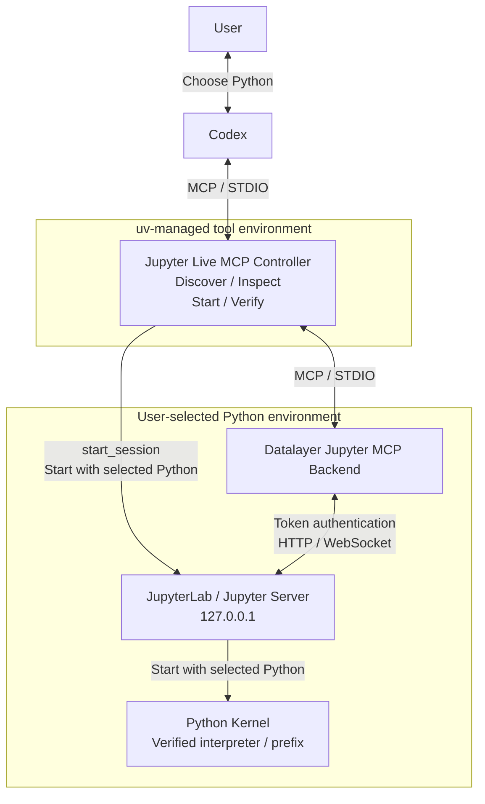

# Jupyter Live MCP

사용자가 선택한 Python 환경에서 JupyterLab과 커널을 실행하고, Codex에 노트북 읽기·편집·실행 도구를 제공하는 MCP 서버입니다.

## 시작하기

수동 설치에는 Python 3.11 이상, `uv`, Codex CLI가 필요합니다.

```sh
uv tool install git+https://github.com/jlee-ax/jupyter-live-mcp@main
codex mcp add jupyterLive -- jupyter-live-mcp serve
codex mcp list
```

등록 후 새 Codex 세션에서 작업할 프로젝트를 지정하고 다음과 같이 요청하세요.

> 이 프로젝트에서 Jupyter Live를 시작하세요. 사용할 Python 환경을 먼저 보여주고 물어보세요.

후보 목록에서 Python을 선택하거나 실행 파일 경로를 지정합니다. 요청에 Python 경로를 이미 지정했다면 그 환경을 사용합니다.

플러그인으로 설치했다면 `/jupyter live`로 시작합니다. 플러그인의 MCP 설정이 `uvx`로 컨트롤러를 실행하므로 수동 MCP 등록은 생략합니다.

## 아키텍처

Jupyter를 기동하기 전 Codex가 Python 환경 후보를 제시하고 사용자의 선택을 받도록 설계했습니다. 
이를 위해 환경 탐색·의존성 검사를 담당하는 컨트롤러를 분석 환경과 분리했고, `uv` 도구 환경에서 먼저 실행하도록 구성했습니다. Jupyter 서버·Datalayer 백엔드, 노트북 커널은 사용자 선택이 확정된 뒤 해당 Python 인터프리터로 기동됩니다.



## Python 환경 구성

| 패키지 | 버전 범위 | 역할 |
| --- | --- | --- |
| `jupyterlab` | `>=4,<5` | JupyterLab 서버와 웹 인터페이스 |
| `jupyter-collaboration` | `>=4,<5` | 노트북의 실시간 공동 편집 |
| `ipykernel` | `>=6,<8` | Python 셀 실행 |
| `jupyter-mcp-server` | `==1.1.4` | Datalayer 노트북 조작 백엔드 |
| `code-sandboxes` | `==0.17.0` | Datalayer의 Jupyter 백엔드 선택 |

환경 검사에서 누락되거나 호환되지 않는 패키지를 확인합니다. 환경 생성과 의존성 설치는 사용자 요청에 따라 수행하며, 설치에는 `uv pip --python`을 사용합니다. 기존 환경에 설치할 경우 패키지 버전이 변경될 수 있습니다. `code-sandboxes`의 버전 고정 이유는 [검증 기록](VERIFICATION.md)에 정리했습니다.

CLI로 환경 목록을 조회할 수 있습니다. 다음은 프로젝트의 `.venv`를 검사하는 예입니다.

```sh
jupyter-live-mcp environments --project .
jupyter-live-mcp inspect .venv/bin/python
```

## 노트북 작업과 세션 관리

동봉된 [Codex 작업 지침](skills/jupyter/SKILL.md)은 셀 읽기 → 편집·실행 → 결과 확인 순서로 작업하도록 합니다. 코드 셀을 기본으로 사용하고, 작업 중인 커널을 재사용합니다.

`session_info`는 Python 경로, 커널 ID, Jupyter 주소와 토큰 파일 경로를 반환합니다. 토큰 값은 포함하지 않습니다. JupyterLab을 자동으로 열려면 Codex에 브라우저 연동 도구가 있어야 합니다.

MCP 연결이 종료되어도 Jupyter 프로세스와 커널은 유지됩니다. 보존된 세션을 조회하고 종료하려면 다음 명령을 사용합니다.

```sh
jupyter-live-mcp sessions
jupyter-live-mcp stop --state-dir /path/to/session
```

`--state-dir`에는 조회 결과의 `state_dir` 값을 지정합니다. 연결 중에는 `stop_session`으로 종료합니다. 활성 세션의 Python을 바꾸려면 먼저 해당 세션을 종료해야 합니다.

## MCP 도구

| 도구 | 입력 | 기능 |
| --- | --- | --- |
| `discover_environments` | `project` | 프로젝트에서 사용할 Python 후보 탐색 |
| `inspect_environment` | `python_path` | Python 버전과 의존성 검사 |
| `create_environment` | `base_python`, `target_path` | 새 경로에 가상환경 생성 |
| `install_dependencies` | `python_path` | 선택한 환경에 필수 패키지 설치 |
| `start_session` | `project`, `python_path` | Jupyter와 백엔드 기동, 커널 검증 |
| `session_info` | 없음 | 현재 세션 정보 조회 |
| `stop_session` | 없음 | 현재 세션 종료 |

`project`의 기본값은 컨트롤러의 작업 디렉터리입니다. 세션 시작 후에는 `list_files`, `use_notebook`, `read_cell`, `edit_cell_source`, `execute_cell` 등의 Datalayer 노트북 도구를 사용할 수 있습니다.

## 개발 및 검증

로컬 소스를 설치하려면 저장소 루트에서 `uv tool install .`을 실행하고, 시작하기에 나온 명령으로 MCP 서버를 등록합니다.

정적 검사, 단위 테스트와 wheel 빌드는 다음과 같이 실행합니다.

```sh
uv sync --group dev
uv run ruff check .
uv run ruff format --check .
uv run basedpyright
uv run pytest -m 'not integration'
uv build --wheel
```

통합 테스트는 실제 Jupyter와 MCP 프로세스를 시작합니다. 개발 환경에 분석용 의존성을 설치한 뒤 실행합니다.

```sh
uv pip install 'jupyterlab>=4,<5' 'jupyter-collaboration>=4,<5' 'ipykernel>=6,<8' 'jupyter-mcp-server==1.1.4' 'code-sandboxes==0.17.0'
uv run --no-sync pytest -m integration
```

실행 검증은 macOS와 Python 3.12에서 수행했습니다. Windows·Linux 실행 및 GitHub Actions 실행은 아직 검증하지 않았습니다. 테스트 결과와 설치 검증 범위는 [VERIFICATION.md](VERIFICATION.md)를 참고하세요.

GitHub Actions 설정은 [ci/github-actions.yml](ci/github-actions.yml)에 템플릿으로 제공합니다. 자동 실행하려면 `.github/workflows/ci.yml`에 배치합니다.

## 라이선스

이 프로젝트는 [MIT 라이선스](LICENSE)를 사용합니다. 노트북 백엔드인 [Datalayer Jupyter MCP Server](https://github.com/datalayer/jupyter-mcp-server)는 BSD 3-Clause 라이선스를 사용합니다.
