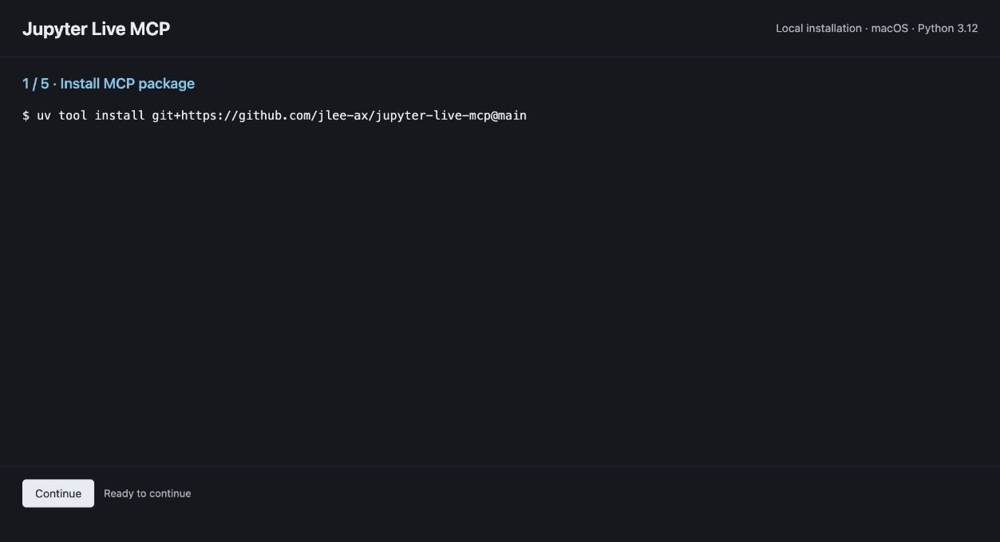
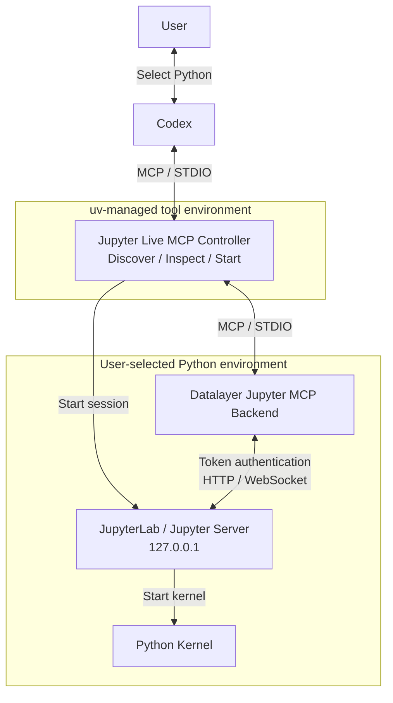

# Jupyter Live MCP

사용자가 선택한 Python 환경에서 JupyterLab과 커널을 실행하고, Codex에 노트북 읽기·편집·실행 도구를 제공하는 MCP 서버입니다.

기존 가상환경을 사용하거나 새 환경을 생성하고, 필요한 Jupyter 의존성을 설치할 수 있습니다.



macOS에서 기록한 설치 로그와 JupyterLab 실행 화면입니다.

## 설치

수동 설치에는 Python 3.11 이상, `uv`, Codex CLI가 필요합니다.

```sh
uv tool install git+https://github.com/jlee-ax/jupyter-live-mcp@main
codex mcp add jupyterLive -- jupyter-live-mcp serve
codex mcp list
```


## 아키텍처

Jupyter 기동 전 사용자가 Python 환경을 선택할 수 있도록 컨트롤러를 독립된 `uv` 환경에서 실행합니다. 서버·백엔드·커널은 선택한 Python으로 기동합니다.



## Python 환경

Codex에서 프로젝트의 가상환경이나 Conda 환경을 선택하거나, Python 실행 파일 경로를 지정합니다. 새 가상환경은 기반 Python과 생성 경로를 지정해 만듭니다.

분석 환경에는 Python 3.11 이상과 다음 패키지가 필요합니다.

| 패키지 | 버전 |
| --- | --- |
| `jupyterlab` | `>=4,<5` |
| `jupyter-collaboration` | `>=4,<5` |
| `ipykernel` | `>=6,<8` |
| `jupyter-mcp-server` | `==1.1.4` |
| `code-sandboxes` | `==0.17.0` |

환경 생성과 의존성 설치는 사용자 요청에 따라 수행하며, 의존성은 선택한 환경에 설치합니다.

## 세션 관리

MCP 연결이 종료돼도 Jupyter와 커널은 유지됩니다. 실행 환경을 바꾸려면 현재 세션을 종료합니다.

```sh
jupyter-live-mcp sessions
jupyter-live-mcp stop --state-dir /path/to/session
```

`--state-dir`에는 조회 결과의 `state_dir` 값을 지정합니다.

## MCP 도구

| 도구 | 입력 | 기능 |
| --- | --- | --- |
| `discover_environments` | `project` | Python 환경 탐색 |
| `inspect_environment` | `python_path` | 환경·의존성 검사 |
| `create_environment` | `base_python`, `target_path` | 가상환경 생성 |
| `install_dependencies` | `python_path` | 의존성 설치 |
| `start_session` | `project`, `python_path` | 세션 시작 |
| `session_info` | 없음 | 실행 환경·커널·접속 정보 조회 |
| `stop_session` | 없음 | 현재 세션 종료 |

노트북 도구는 세션 시작 후 제공됩니다.

## 개발 및 검증

로컬 소스 설치는 저장소 루트에서 `uv tool install .`을 실행합니다.

```sh
uv sync --group dev
uv run ruff check .
uv run ruff format --check .
uv run basedpyright
uv run pytest -m 'not integration'
uv build --wheel
```

통합 테스트는 개발 환경에 분석용 의존성을 설치한 뒤 실행합니다.

```sh
uv run --no-sync pytest -m integration
```

실행 검증 환경은 macOS·Python 3.12입니다. 결과는 [검증 기록](VERIFICATION.md), GitHub Actions 설정은 [CI 템플릿](ci/github-actions.yml)을 참고하세요.

## 라이선스

이 프로젝트는 [MIT 라이선스](LICENSE)를 사용합니다. [Datalayer Jupyter MCP Server](https://github.com/datalayer/jupyter-mcp-server)는 BSD 3-Clause 라이선스를 사용합니다.
