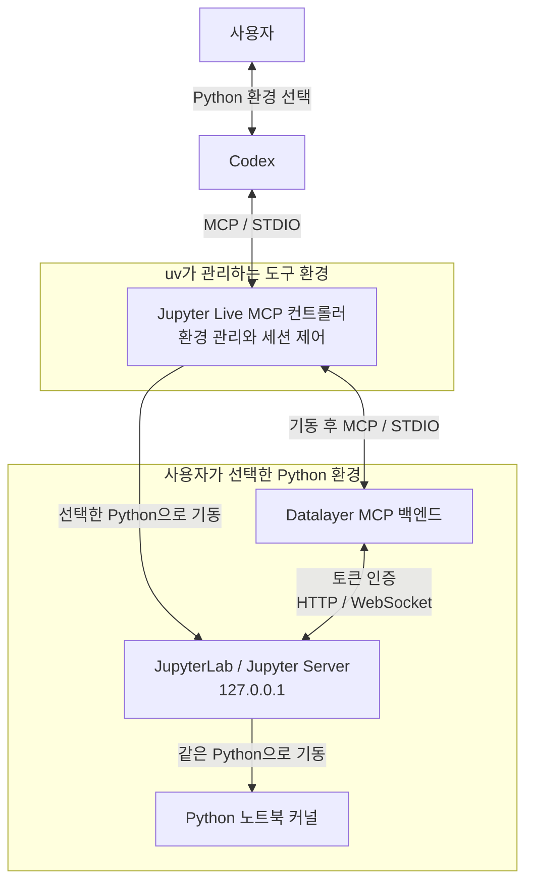

# Jupyter Live MCP

Codex에서 사용할 Python 환경을 선택하고, 그 환경의 JupyterLab과 커널로 노트북을 작업하는 로컬 MCP 서버입니다. 환경 탐색과 세션 기동은 이 패키지가, 노트북 읽기·편집·실행은 Datalayer Jupyter MCP Server가 담당합니다.

## 시작하기

Python 3.11 이상과 `uv`를 준비합니다. Codex CLI에 MCP 서버를 직접 등록하려면 다음 명령을 실행합니다.

```sh
uv tool install git+https://github.com/jlee-ax/jupyter-live-mcp@main
codex mcp add jupyterLive -- jupyter-live-mcp serve
codex mcp list
```

첫 번째 명령은 GitHub의 `main` 소스를 `uv` 도구 환경에 설치합니다. 두 번째 명령은 Codex에 서버 시작 명령을 등록하고, 마지막 명령은 등록 결과를 확인합니다. `codex`와 `jupyter-live-mcp` 실행 파일은 PATH에서 찾을 수 있어야 합니다.

등록 후 새 Codex 세션에서 작업할 프로젝트를 지정하고 다음과 같이 요청합니다.

> 이 프로젝트에서 Jupyter Live를 시작하세요. 사용할 Python 환경을 먼저 보여주고 물어보세요.

Codex가 환경 후보를 제시하면 사용할 Python을 선택합니다. 의존성 검사가 끝나고 세션이 시작되면 노트북을 열어 셀을 읽고, 수정하고, 실행할 수 있습니다. 이미 Python 경로를 지정한 요청이라면 그 선택을 사용합니다.

Codex 플러그인으로 설치한 경우에는 `/jupyter live`로 호출합니다. 동봉된 MCP 설정이 `uvx`로 컨트롤러를 시작하므로 위의 수동 MCP 등록은 별도로 실행하지 않습니다.

## 동작 원리

환경 선택을 처리하는 컨트롤러와 노트북 코드를 실행하는 분석 환경을 분리합니다. 이 구성 덕분에 Jupyter를 시작하기 전에 MCP로 환경을 탐색하고 사용자에게 선택을 받을 수 있습니다.



MCP 연결 직후에는 `jupyter-live-mcp serve` 컨트롤러가 실행되고 환경 관리·세션 제어 도구가 제공됩니다. 사용자가 Python을 선택하면 Codex가 프로젝트 경로와 Python 실행 파일 경로를 `start_session`에 전달합니다.

컨트롤러는 선택한 Python으로 JupyterLab과 Datalayer 백엔드를 실행하고, 같은 실행 파일을 사용하는 커널 설정을 생성합니다. 시작 직후 커널의 `sys.executable`과 `sys.prefix`를 검사해 선택한 환경과 일치하는지 확인합니다. 검증이 끝나면 노트북 도구가 Codex의 도구 목록에 추가됩니다.

Codex–컨트롤러와 컨트롤러–백엔드의 MCP 연결은 표준 입출력(STDIO)을 사용합니다. 별도의 MCP 네트워크 포트 없이 프로세스 사이에서 요청과 결과를 전달하는 방식입니다. 백엔드는 루프백 주소의 Jupyter Server에 토큰 인증으로 접속하고, HTTP API와 WebSocket으로 파일·커널·노트북 상태를 조작합니다. 등록 방식은 [Codex MCP 문서](https://developers.openai.com/codex/mcp)를 참고하세요.

## Python 환경 구성

실행 환경은 Python 실행 파일의 경로로 지정합니다. 프로젝트의 `.venv`와 `venv`, `VIRTUAL_ENV`와 `CONDA_PREFIX`, Conda 환경 목록, 현재 프로세스와 PATH의 Python을 탐색합니다. 목록에 없는 환경도 실행 파일의 절대 경로로 선택할 수 있습니다.

선택한 환경에는 Python 3.11 이상과 다음 패키지가 필요합니다.

| 패키지 | 버전 범위 | 역할 |
| --- | --- | --- |
| `jupyterlab` | `>=4,<5` | Jupyter 서버와 웹 작업 화면 |
| `jupyter-collaboration` | `>=4,<5` | 노트북의 실시간 공동 편집 |
| `ipykernel` | `>=6,<8` | Python 셀 실행 |
| `jupyter-mcp-server` | `==1.1.4` | Datalayer 노트북 조작 백엔드 |
| `code-sandboxes` | `==0.17.0` | 백엔드의 Jupyter 실행 연동 |

환경 검사는 누락되거나 호환되지 않는 패키지를 반환합니다. 사용자가 요청하면 새 가상환경을 생성하거나 `uv pip --python`으로 선택한 환경에 의존성을 설치합니다. 기존 환경에 설치할 경우 패키지 버전이 변경될 수 있습니다. `code-sandboxes`의 버전 고정 이유는 [검증 기록](VERIFICATION.md)에 정리했습니다.

환경 목록과 준비 상태는 CLI에서도 확인할 수 있습니다.

```sh
jupyter-live-mcp environments --project .
jupyter-live-mcp inspect /absolute/path/to/environment/bin/python
```

## 노트북 작업과 세션 관리

노트북 작업은 MCP를 통해 수행합니다. Codex는 대상 노트북과 셀을 읽은 뒤 필요한 셀을 편집·실행하고, 변경된 셀과 출력을 다시 확인합니다. 기본 셀 형식은 코드이며, 기존 커널의 변수와 작업 상태를 유지합니다.

`session_info`는 선택한 Python, 커널 ID, Jupyter 주소와 로컬 토큰 파일 경로를 반환합니다. 인증 토큰 자체는 결과에 포함하지 않습니다. JupyterLab 화면을 여는 기능은 Codex 호스트의 브라우저 연동에 따라 제공됩니다.

MCP 연결이 종료되어도 Jupyter 프로세스와 커널은 유지됩니다. 보존된 세션을 조회하고 종료하려면 다음 명령을 사용합니다.

```sh
jupyter-live-mcp sessions
jupyter-live-mcp stop --state-dir /exact/state_dir/from/sessions
```

`state_dir`에는 조회 결과의 해당 세션 경로를 지정합니다. 연결 중에는 `stop_session`으로 종료할 수 있습니다. 활성 세션의 Python을 바꾸려면 먼저 그 세션을 명시적으로 종료해야 합니다.

## MCP 도구

| 도구 | 입력 | 기능 |
| --- | --- | --- |
| `discover_environments` | `project` | 프로젝트에서 사용할 Python 후보 탐색 |
| `inspect_environment` | `python_path` | Python 버전과 의존성 검사 |
| `create_environment` | `base_python`, `target_path` | 새 경로에 가상환경 생성 |
| `install_dependencies` | `python_path` | 선택한 환경에 필수 패키지 설치 |
| `start_session` | `project`, `python_path` | Jupyter와 백엔드 기동, 커널 검증 |
| `session_info` | 없음 | 현재 세션 정보 조회 |
| `stop_session` | 없음 | 현재 세션 종료 |

`project`의 기본값은 컨트롤러의 작업 디렉터리입니다. 세션 시작 후에는 `list_files`, `use_notebook`, `read_cell`, `edit_cell_source`, `execute_cell` 등의 Datalayer 노트북 도구를 사용할 수 있습니다.

## 개발 및 검증

로컬 소스를 설치하려면 저장소 루트에서 `uv tool install .`을 실행하고, 시작하기에 나온 명령으로 MCP 서버를 등록합니다.

정적 검사, 단위 테스트와 wheel 빌드는 다음과 같이 실행합니다.

```sh
uv sync --group dev
uv run ruff check .
uv run ruff format --check .
uv run basedpyright
uv run pytest -m 'not integration'
uv build --wheel
```

통합 테스트는 실제 Jupyter와 MCP 프로세스를 시작합니다. 개발 환경에 분석용 의존성을 설치한 뒤 실행합니다.

```sh
uv pip install 'jupyterlab>=4,<5' 'jupyter-collaboration>=4,<5' 'ipykernel>=6,<8' 'jupyter-mcp-server==1.1.4' 'code-sandboxes==0.17.0'
uv run --no-sync pytest -m integration
```

실행 검증은 macOS와 Python 3.12에서 수행했습니다. Windows·Linux 실행 및 GitHub Actions 실행은 아직 검증하지 않았습니다. 테스트 결과와 설치 검증 범위는 [VERIFICATION.md](VERIFICATION.md)를 참고하세요.

GitHub Actions 설정은 [ci/github-actions.yml](ci/github-actions.yml)에 템플릿으로 제공합니다. 자동 실행하려면 `.github/workflows/ci.yml`에 배치합니다.

## 라이선스

이 프로젝트는 [MIT 라이선스](LICENSE)를 사용합니다. 노트북 백엔드인 [Datalayer Jupyter MCP Server](https://github.com/datalayer/jupyter-mcp-server)는 BSD 3-Clause 라이선스를 사용하며, 이 패키지는 해당 배포 패키지에 의존합니다.
