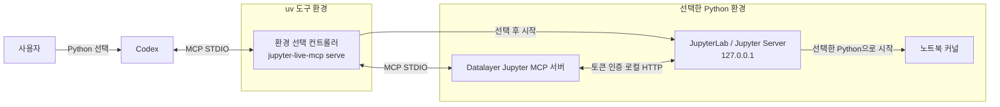

# Jupyter Live MCP

Jupyter Live MCP는 선택한 Python 인터프리터에서 JupyterLab과 노트북 커널을 실행하고, Datalayer Jupyter MCP 서버를 통해 노트북을 제어합니다.

## 설치

Python 3.11 이상과 `uv`가 필요합니다. 아래 명령은 Codex CLI에 로컬 MCP 서버를 직접 등록하는 방법입니다.

### GitHub에서 설치

`main`은 개발 브랜치를 가리킵니다. 릴리스가 제공되면 검증한 태그로 고정할 수 있습니다.

```sh
uv tool install git+https://github.com/jlee-ax/jupyter-live-mcp@main
codex mcp add jupyterLive -- jupyter-live-mcp serve
```

Codex 플러그인 설치 경로에서는 `.codex-plugin/plugin.json`이 MCP 설정과 스킬 경로를 선언합니다. `.mcp.json`은 `uvx`로 같은 컨트롤러를 실행하므로, `codex mcp add`를 별도로 실행하지 않습니다.

### 로컬 소스에서 설치

이 저장소의 루트에서 실행합니다.

```sh
uv tool install .
codex mcp add jupyterLive -- jupyter-live-mcp serve
```

두 설치 방식 모두 도구의 실행 파일 경로가 PATH에 포함되어 있어야 합니다. 등록 후 새 Codex 세션에서 연결하고 다음과 같이 요청합니다.

> Jupyter Live를 시작하세요. 사용할 Python 환경을 먼저 보여주고 물어보세요.

이미 Python 경로를 지정했다면 같은 선택을 다시 묻지 않습니다. 환경 생성이나 패키지 설치가 필요한 경우에는 해당 변경을 요청한 뒤 진행합니다.

## 분석 환경 준비

선택한 환경은 Python 3.11 이상이어야 하며 다음 배포 패키지가 필요합니다.

| 패키지 | 지원 범위 |
| --- | --- |
| `jupyterlab` | `>=4,<5` |
| `jupyter-collaboration` | `>=4,<5` |
| `ipykernel` | `>=6,<8` |
| `jupyter-mcp-server` | `==1.1.4` |
| `code-sandboxes` | `==0.17.0` |

`code-sandboxes`는 Datalayer `1.1.4`의 Jupyter 백엔드 선택 방식과 맞도록 고정합니다. `1.10.0`에서는 `jupyter` 백엔드 이름을 인식하지 못하는 오류가 확인되었습니다. 검사 단계에서 호환되지 않는 버전을 표시하며, 명시적인 설치 요청 전에는 환경을 변경하지 않습니다.

`inspect_environment`는 설치된 배포 패키지의 버전을 검사해 부족하거나 호환되지 않는 항목을 반환합니다. 새 환경은 `create_environment`를 명시적으로 요청했을 때만 생성하며, 기존 경로를 덮어쓰지 않습니다. `install_dependencies`를 명시적으로 요청하면 `uv pip --python`으로 선택한 환경에 필요한 패키지를 설치합니다. 이 과정에서 해당 환경의 기존 패키지와 의존성 버전이 변경될 수 있으므로, 별도 환경이 필요하면 새 환경 생성을 선택하세요.

CLI에서도 환경 상태를 확인할 수 있습니다.

```sh
jupyter-live-mcp environments --project .
jupyter-live-mcp inspect /absolute/path/to/environment/bin/python
```

Windows의 venv는 보통 `Scripts/python.exe`, Conda는 환경 루트의 `python.exe`를 사용합니다. 표시된 실제 실행 파일 경로를 선택하세요.

## 사용

1. `discover_environments`로 대상 프로젝트의 환경을 찾고 사용자에게 Python을 선택받습니다.
2. `inspect_environment`로 선택한 환경을 검사합니다. 필요한 생성·설치는 사용자 요청에 따라 수행합니다.
3. `start_session`에 `project`와 `python_path`를 전달합니다.
4. 도구 목록을 다시 조회하고, Jupyter MCP 도구로 노트북을 탐색·읽기·수정·실행합니다.
5. `session_info`에서 선택한 환경, 커널, 브라우저 URL, 로컬 `token_file` 경로를 확인합니다.

노트북은 MCP로 수정합니다. 수정 전 해당 노트북과 셀을 읽고, 기본적으로 코드 셀을 사용하며, 실행 후 셀과 출력을 다시 확인합니다. 기존 커널을 공유 상태로 유지하고 사용자의 요청 없이 재시작하지 않습니다.

JupyterLab은 인증을 사용하는 루프백 주소에 바인딩됩니다. 토큰 자체는 MCP 결과에 포함하지 않습니다. 브라우저 자동 열기는 Codex 등 호스트의 브라우저 연동 기능에 따라 선택적으로 수행합니다. 토큰 파일의 내용이나 토큰을 포함한 인증 URL을 대화·로그·저장소에 노출하지 마세요.

## 런타임 구성

`uv tool install`은 환경 선택 컨트롤러를 `uv`의 도구 환경에 설치합니다. `codex mcp add`는 그 컨트롤러의 시작 명령을 Codex에 등록합니다. 연결 시 Codex는 `jupyter-live-mcp serve`를 로컬 프로세스로 실행하고 표준 입력·출력(STDIO)으로 MCP 메시지를 주고받습니다. 이때 JupyterLab이나 커널은 아직 시작되지 않습니다. 플러그인 설치 방식에서는 `.mcp.json`에 정의된 `uvx` 명령이 같은 컨트롤러를 시작합니다. [Codex의 MCP 연결 문서](https://developers.openai.com/codex/mcp)에도 로컬 STDIO 서버의 등록 방식이 설명되어 있습니다.



두 MCP 연결은 STDIO를 사용하므로 MCP용 네트워크 포트를 열지 않습니다. 노트북 작업의 HTTP 통신은 백엔드와 루프백 주소의 Jupyter Server 사이에서 이루어집니다.

처음에는 컨트롤러의 환경 탐색·검사 도구만 Codex에 노출됩니다. Codex가 후보를 보여주고 사용자의 선택을 받으면, 컨트롤러가 해당 Python의 의존성을 검사한 뒤 `start_session`에서 JupyterLab을 실행합니다. 커널 설정과 Datalayer MCP 백엔드도 같은 Python 인터프리터를 사용합니다. 백엔드는 토큰으로 인증된 로컬 HTTP 연결을 통해 Jupyter에 접근하고, 컨트롤러는 그 노트북 도구를 Codex에 전달합니다.

프로젝트의 `.venv`·`venv`, `VIRTUAL_ENV`·`CONDA_PREFIX`, Conda 환경 목록, 현재/PATH의 Python을 탐색합니다. 목록에 없는 환경도 Python 실행 파일의 절대 경로로 지정할 수 있습니다. 컨트롤러는 선택한 경로의 심볼릭 링크를 유지하고, 시작 직후 커널의 `sys.executable`과 `sys.prefix`가 선택한 환경과 일치하는지 검증합니다.

## 세션 보존과 종료

MCP 연결이 종료되어도 사용자가 작업 중인 Jupyter 프로세스와 커널을 보존합니다. 남은 세션은 CLI로 확인하고, 종료가 필요할 때 정확한 `state_dir`를 지정합니다.

```sh
jupyter-live-mcp sessions
jupyter-live-mcp stop --state-dir /exact/state_dir/from/sessions
```

연결 중인 세션은 사용자가 종료를 요청하면 `stop_session`으로 중지할 수 있습니다. 선택 환경을 변경할 때도 실행 중인 커널을 임의로 종료하거나 교체하지 않습니다.

## 개발 및 검증

```sh
uv sync --group dev
uv run ruff check .
uv run ruff format --check .
uv run basedpyright
uv run pytest -m 'not integration'
uv build --wheel
```

통합 테스트는 실제 Jupyter와 MCP 프로세스를 시작합니다. 통합 테스트용 환경에 위 분석 환경 패키지를 준비한 뒤 실행합니다.

```sh
uv pip install 'jupyterlab>=4,<5' 'jupyter-collaboration>=4,<5' 'ipykernel>=6,<8' 'jupyter-mcp-server==1.1.4' 'code-sandboxes==0.17.0'
uv run --no-sync pytest tests/test_server.py
```

현재 로컬 QA 플랫폼은 macOS입니다. Windows와 Linux의 동작은 아직 검증 완료로 주장하지 않습니다. `ci/github-actions.yml`은 깨끗한 환경에서의 정적 검사·단위 테스트·wheel 빌드와 별도의 Linux 통합 테스트를 위한 템플릿입니다. 자동 CI를 활성화하려면 GitHub의 workflow 쓰기 권한이 있는 연결로 이 파일을 `.github/workflows/ci.yml`에 배치하세요. 현재 연결에는 해당 권한이 없어 템플릿으로 제공합니다.

## 라이선스와 기반 프로젝트

이 프로젝트의 코드는 [MIT 라이선스](LICENSE)로 제공합니다. 노트북 조작 백엔드는 [Datalayer Jupyter MCP Server](https://github.com/datalayer/jupyter-mcp-server)의 `1.1.4` 배포 패키지를 사용합니다. Datalayer 프로젝트는 BSD 3-Clause 라이선스이며, 해당 소스 코드를 이 저장소에 복제해 포함하지 않습니다. Jupyter 관련 의존성의 라이선스는 각 프로젝트에 따릅니다.
