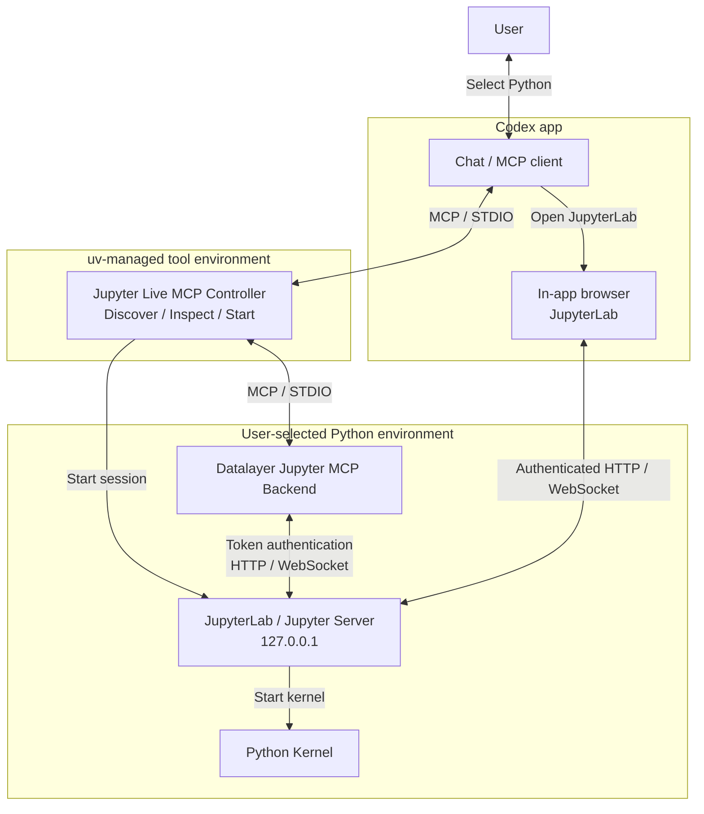

# Jupyter Live MCP

[English](README.md) | [한국어](README.ko.md)

An MCP server that runs JupyterLab and notebook kernels in a user-selected Python environment and provides Codex with tools to read, edit, and execute notebooks.

Use the Codex app for notebook operations and its in-app browser to view JupyterLab.


## Installation

Requires Python 3.11 or later, `uv`, the Codex app, and the `codex` CLI for MCP registration.

```sh
uv tool install git+https://github.com/jlee-ax/jupyter-live-mcp@main
codex mcp add jupyterLive -- jupyter-live-mcp serve
```

## Architecture

The controller runs in a dedicated tool environment managed by `uv` so that the Python environment can be selected before Jupyter starts. The Jupyter server, MCP backend, and notebook kernel run with the selected Python interpreter.



## Python environments

Select a project virtual environment or Conda environment in Codex, or provide a Python executable path. To create a virtual environment, specify a base Python interpreter and a destination path.

The analysis environment requires Python 3.11 or later and the following packages.

| Package | Version |
| --- | --- |
| `jupyterlab` | `>=4,<5` |
| `jupyter-collaboration` | `>=4,<5` |
| `ipykernel` | `>=6,<8` |
| `jupyter-mcp-server` | `==1.1.4` |
| `code-sandboxes` | `==0.17.0` |

Dependencies are checked in the selected environment. Environment creation and package installation require a user request.

## Session management

Jupyter and its kernels remain running after the MCP connection closes. A new MCP connection does not automatically reconnect to an existing session. Stop the existing Jupyter session before changing environments.

```sh
jupyter-live-mcp sessions
jupyter-live-mcp stop --state-dir /path/to/session
```

Use the `state_dir` value returned by `sessions` for `--state-dir`.

## Environment and session tools

| Tool | Input | Purpose |
| --- | --- | --- |
| `discover_environments` | `project` | Discover Python environments |
| `inspect_environment` | `python_path` | Check the interpreter and dependencies |
| `create_environment` | `base_python`, `target_path` | Create a virtual environment |
| `install_dependencies` | `python_path` | Install required dependencies |
| `start_session` | `project`, `python_path` | Start a session |
| `session_info` | None | Get environment, kernel, and connection details |
| `stop_session` | None | Stop the current session |

## Development and verification

To install from local source, run `uv tool install .` at the repository root.

```sh
uv sync --group dev
uv run ruff check .
uv run ruff format --check .
uv run basedpyright
uv run pytest -m 'not integration'
uv build --wheel
```

See [Verification](VERIFICATION.md) for integration test setup, execution, and validation scope. GitHub Actions configuration is provided as a [CI template](ci/github-actions.yml).

## License

This project uses the [MIT License](LICENSE). [Datalayer Jupyter MCP Server](https://github.com/datalayer/jupyter-mcp-server) uses the BSD 3-Clause License.
